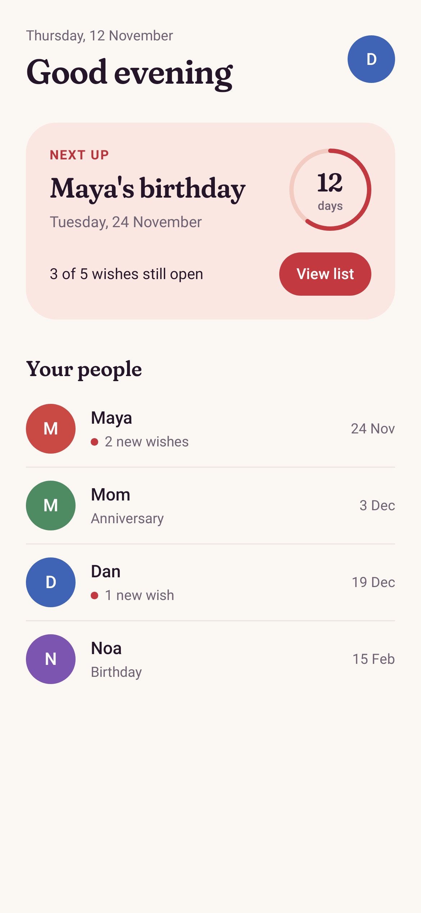
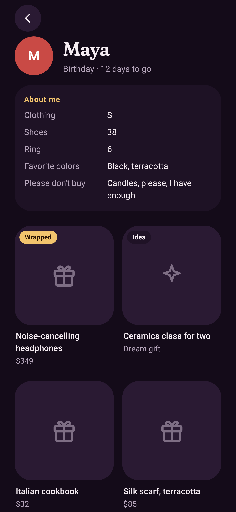
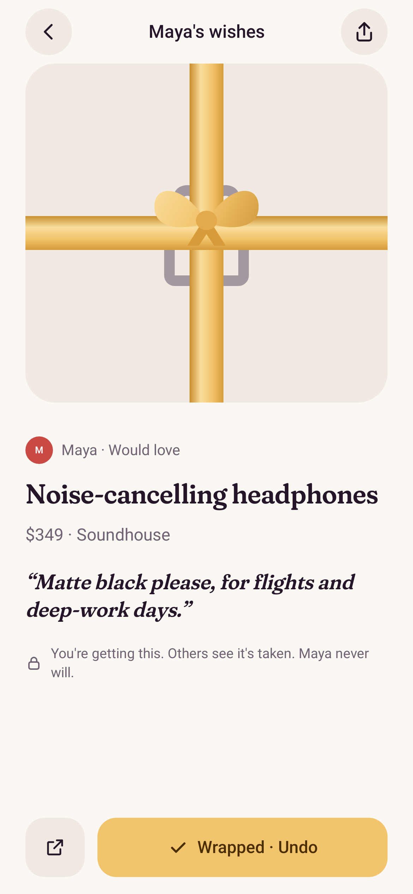
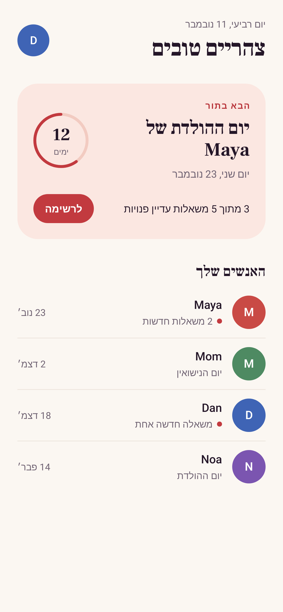

# ThinkOfMe

A shared wish space for the people closest to you: couples, family, friends.
Keep one wishlist, choose who sees each wish, and let your people secretly
claim gifts so every present stays a surprise. Birthday and anniversary
reminders make sure nobody is caught empty-handed.

Native apps: **SwiftUI** (iOS 18+) and **Jetpack Compose** (Android 8+), backed by **Firebase**.
Languages: English, Hebrew, Arabic, Russian (right-to-left layouts included).

<p>
  
  
  
  
</p>

See [`docs/PLAN.md`](docs/PLAN.md) for the product and engineering plan.

## Repository

| Path | What |
|---|---|
| `android/` | Compose app: `app`, `core/{model,data,designsystem,ui}`, `feature/{home,wishes,circles,occasions,account}` |
| `ios/` | SwiftUI app (XcodeGen `project.yml`), `Packages/Core` and `Packages/DesignSystem` |
| `backend/` | Firestore/Storage security rules, indexes, Cloud Functions (TypeScript) and their tests |
| `design/` | `tokens.json` (colors, type, spacing, motion), display fonts, token generator |
| `scripts/` | `sync-strings.py`: Android strings → iOS String Catalog |
| `docs/` | Plan and screenshots |

## Try it on a device (no setup needed)

Both apps run in **demo mode** when built without a Firebase config: a sample
world (Maya, Mom, Dan, Noa) lives on the device, so every screen works.

**Android**: open `android/` in Android Studio and press Run, or:

```sh
cd android && ./gradlew :app:installDebug
```

A debug APK is also attached to every CI run (Actions → Android → `thinkofme-debug-apk`).

**iOS**: requires Xcode 26 on a Mac.

```sh
brew install xcodegen
cd ios && xcodegen && open ThinkOfMe.xcodeproj
```

Select your team under *Signing & Capabilities* (or set `DEVELOPMENT_TEAM` in
`ios/Config/Secrets.xcconfig`, see `Secrets.example.xcconfig`) and run on your iPhone.

## Connect Firebase

1. Create the Firebase project and apps as described in [`docs/PLAN.md` §5](docs/PLAN.md#5-account-setup-checklist-owner).
2. **Backend**: install the CLI, select your project, deploy rules, indexes and functions:
   ```sh
   cd backend && npm i -g firebase-tools && firebase login && firebase use --add
   cd functions && npm ci && npm run deploy
   ```
3. **Android**: put `google-services.json` in `android/app/`. For Google sign-in, add your
   debug and release SHA-1 fingerprints in Firebase → Project settings → Android app
   (`./gradlew :app:signingReport` prints them).
4. **iOS**: put `GoogleService-Info.plist` in `ios/App/`, copy `ios/Config/Secrets.example.xcconfig`
   to `Secrets.xcconfig` and set `GOOGLE_REVERSED_CLIENT_ID` (from the plist) and your team, then
   run `xcodegen` again.
5. **CI**: add repository secrets `GOOGLE_SERVICES_JSON_B64` and `GOOGLE_SERVICE_INFO_PLIST_B64`
   (base64 of each file) to build against the real project.

Config files and keys are git-ignored: this repository is public.

## Development

```sh
# Backend: unit tests and security-rules tests (Firestore emulator, needs Java 21)
cd backend/functions && npm ci && npm test && npm run test:rules

# Android: build and render screenshots of every screen (light/dark, 4 languages)
cd android && ./gradlew :app:assembleDebug :app:recordRoborazziDebug   # → app/build/outputs/roborazzi

# iOS: Core package tests
swift test --package-path ios/Packages/Core

# After editing design/tokens.json or Android strings
node design/generate-tokens.mjs
python3 scripts/sync-strings.py
```

The security rules guarantee the core promise: **a wish's owner can never read or
query claims on their own wishes.** This is enforced on the server and covered by
`backend/functions/test/rules`.
